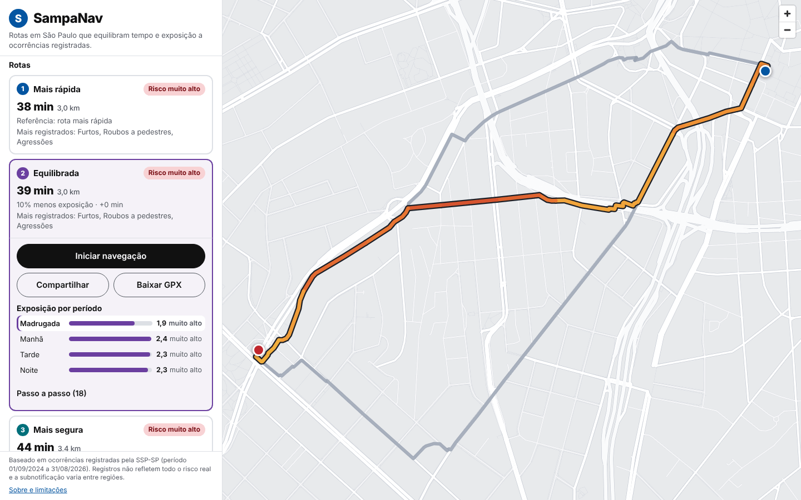
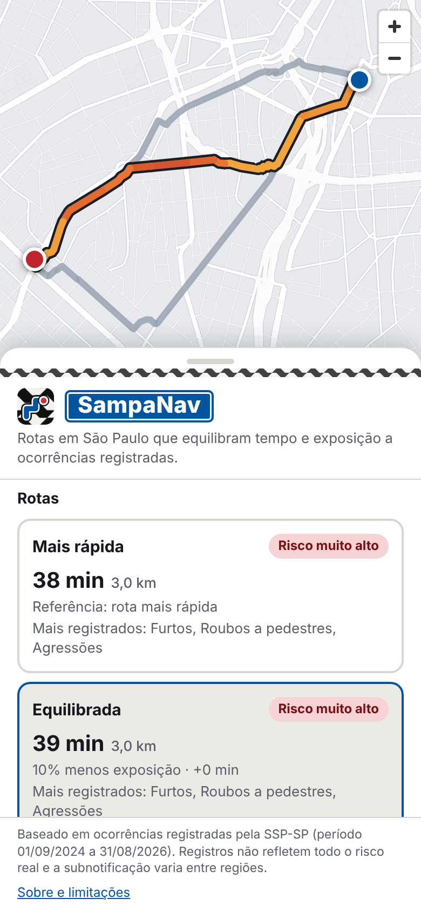
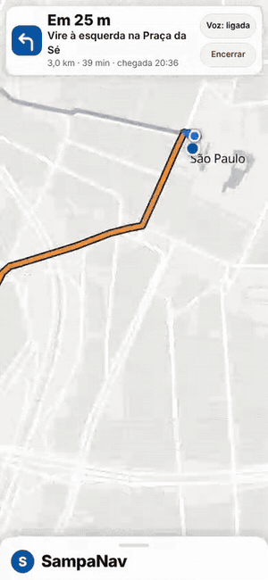
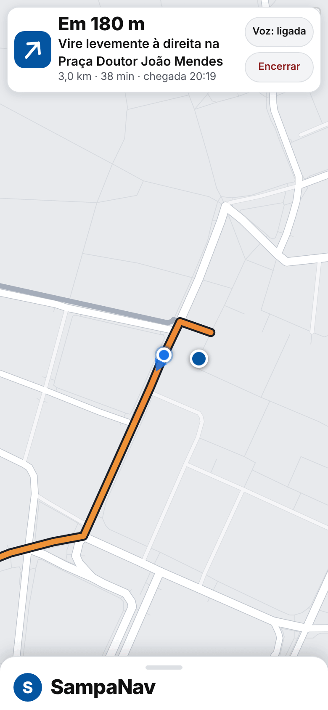
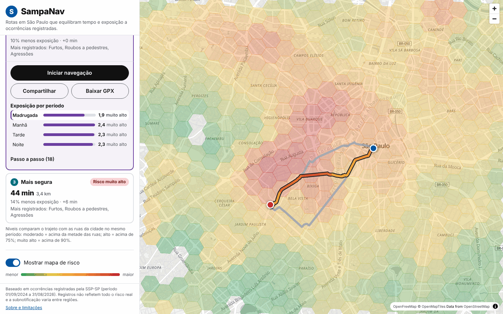
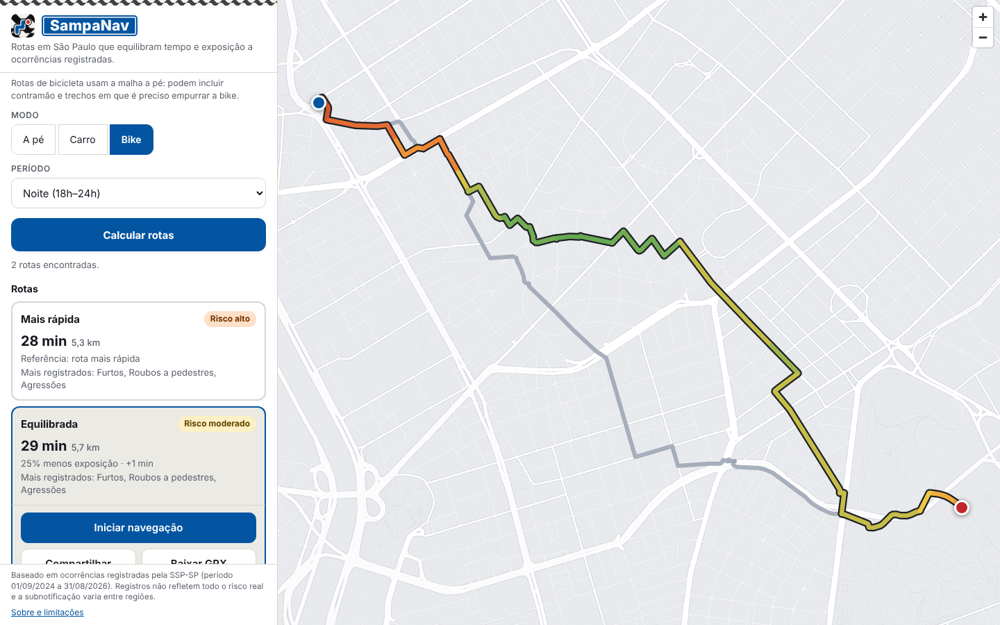
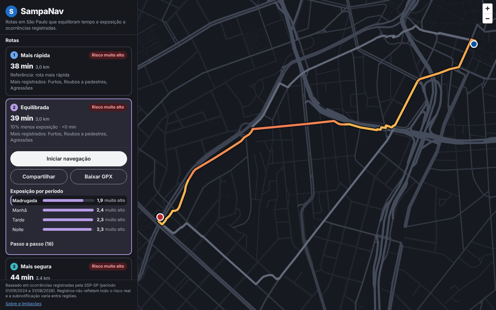
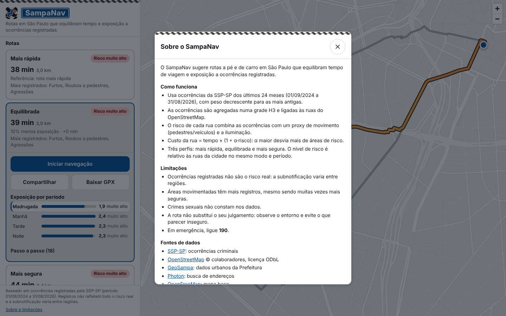
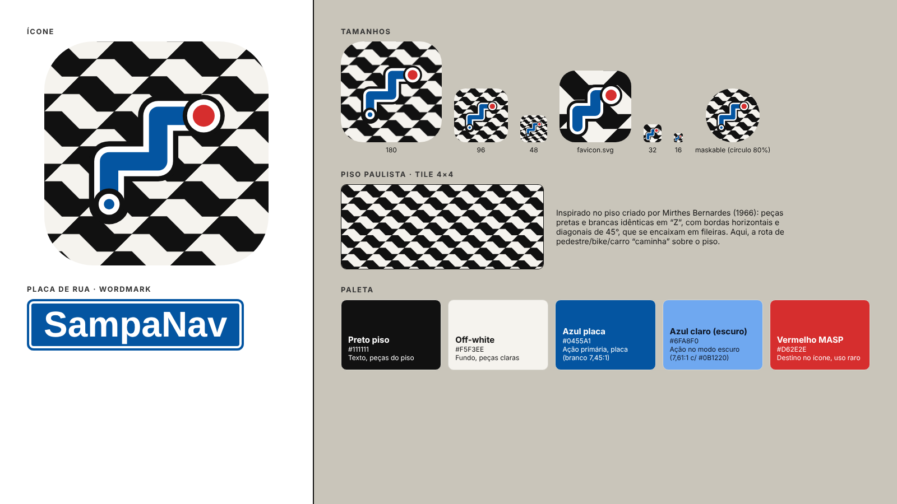
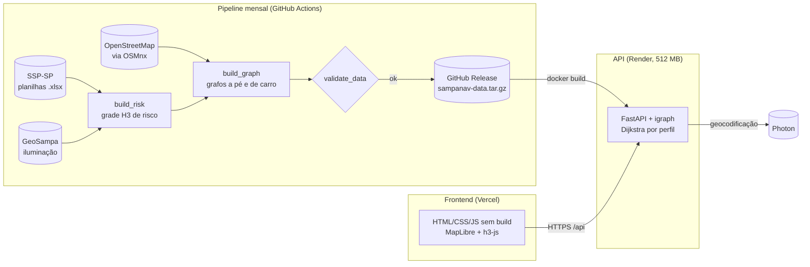

<div align="center">


# SampaNav

**Rotas a pé, de bicicleta ou de carro em São Paulo que equilibram tempo de deslocamento
e exposição a ocorrências criminais registradas pela SSP-SP.**

[](https://sampanav.vercel.app)
[](https://github.com/alexzjss/SampaNav/actions/workflows/ci.yml)
[](https://github.com/alexzjss/SampaNav/releases/latest)
[](LICENSE)


**[Abrir o SampaNav →](https://sampanav.vercel.app)**



</div>

## O que ele faz

Para cada trajeto, o SampaNav calcula até três opções e mostra quanto cada uma reduz a
exposição em troca de quanto tempo a mais:

| Perfil | Peso do risco (α) | Para quem |
|---|---|---|
| **Mais rápida** | 0 | menor tempo, sem considerar risco |
| **Equilibrada** | 2 | compromisso entre tempo e exposição |
| **Mais segura** | 6 | menor exposição, aceitando desvios maiores |

Alternativas que não reduzem a exposição em pelo menos 5% são descartadas, e o app
diz quando nenhum desvio vale a pena. A rota selecionada é colorida trecho a trecho
pelo risco, e a camada de calor mostra o risco por região em cada período do dia.

<table>
  <tr>
    <td align="center" width="33%"><br><sub><b>Celular</b>: painel inferior com os cartões</sub></td>
    <td align="center" width="33%"><br><sub><b>Navegação</b>: próxima manobra, voz e hora de chegada</sub></td>
    <td align="center" width="33%"><br><sub><b>Instruções em português</b></sub></td>
  </tr>
</table>

<table>
  <tr>
    <td width="50%"><br><sub><b>Mapa de risco</b> em grade H3, por período do dia</sub></td>
    <td width="50%"><br><sub><b>Bicicleta</b>: 25% menos exposição por +1 min neste trajeto</sub></td>
  </tr>
  <tr>
    <td width="50%"><br><sub><b>Tema escuro</b>, seguindo o sistema</sub></td>
    <td width="50%"><br><sub><b>Sobre e limitações</b>, dentro do app</sub></td>
  </tr>
</table>

<sub>Capturas geradas com o backend real e os dados de setembro/2024 a agosto/2026
(660 mil ocorrências), sobre o mapa do OpenFreeMap usado no app. Para regerar:
[`tools/screenshots`](tools/screenshots/README.md).</sub>

## Identidade visual

A interface usa a linguagem da sinalização do Metrô de São Paulo: cada perfil de rota é
uma linha numerada, e o passo a passo aparece como uma sequência de estações. As cores
das linhas nunca representam risco; o risco segue a escala própria, do verde ao vermelho.
Detalhes em [`docs/IDENTIDADE.md`](docs/IDENTIDADE.md).



## Funcionalidades

**Rotas**
- **Três perfis** com tempo, distância, nível de risco relativo à cidade, "X% menos
  exposição · +Y min" e as categorias de ocorrência mais registradas no trajeto.
- **A pé, de carro ou de bicicleta.** A bicicleta usa a malha a pé, a ~15 km/h, com
  calçadões e escadas como trechos empurrando a bike. Essa malha não tem mão de
  direção, então a rota pode incluir contramão, e ela ainda não prioriza ciclovias. O
  app avisa isso ao escolher o modo.
- **Parada intermediária** opcional: cada perfil passa por ela, e a lista de passos
  marca a chegada.
- **Exposição por período**: o mesmo trajeto de madrugada, de manhã, à tarde e à noite.
- **Níveis explicados**: "alto" significa acima de 75% das ruas da cidade no mesmo
  período, e assim por diante.

**Navegação**
- **Passo a passo em português** ("Vire à direita na Av. Paulista", "Continue pela
  Rua Augusta por 300 m").
- **Modo GPS**: segue a posição, destaca o passo atual e mostra a distância até a
  próxima manobra, o tempo restante e a hora de chegada.
- **Voz** em pt-BR pelo próprio navegador, com botão para desligar.
- **Recálculo**: após 3 leituras seguidas a mais de 40 m da rota, o app oferece
  recalcular a partir da posição atual.

**Uso no dia a dia**
- **Busca de endereços** com autocomplete, e o **endereço do ponto** ao clicar ou
  arrastar no mapa.
- **Compartilhar por link** (origem, destino, parada, modo, período e rota ficam na URL)
  e **exportar GPX**.
- **Histórico** das últimas 10 buscas, só no navegador.
- **Aviso de servidor acordando**: no plano gratuito a API dorme; o app mostra
  "Acordando o servidor" enquanto ela sobe (veja [Deploy](#deploy-grátis)).
- **Instalável (PWA)**: a interface abre mesmo enquanto a API acorda, e o app avisa
  quando há versão nova. Chamadas à API nunca vão para o cache.
- **Acessível**: navegação por teclado, leitores de tela (auditoria axe sem violações
  nos temas claro e escuro) e tema escuro automático.

## Limitações e uso responsável

Leia antes de usar ou apresentar os resultados.

- **Os dados refletem ocorrências registradas, não o risco real.** Um boletim de
  ocorrência é um indicador imperfeito do que de fato acontece nas ruas.
- **A subnotificação varia entre regiões.** Locais onde as pessoas registram menos
  boletins parecem mais seguros do que são.
- **Áreas movimentadas têm mais registros, em parte por causa do fluxo de
  pessoas.** O Centro, por exemplo, concentra muitas ocorrências também porque
  recebe muito mais gente. Mais registros não significam necessariamente mais
  risco por pessoa.
- **Não use a ferramenta para estigmatizar bairros.** A interface não rotula
  regiões como "perigosas" e o aviso permanente deve ser mantido.
- **Crimes sexuais não entram no modelo.** Na fonte, esses registros vêm sem
  localização (campos zerados e logradouro ocultado), então não há como
  representá-los no mapa.
- **O proxy de movimento é uma aproximação.** Ele vem do tipo de via, não de
  contagens reais de pedestres.
- **Este projeto não substitui julgamento próprio nem orientação de segurança
  pública.** Em caso de emergência, procure os canais oficiais.

## Fontes de dados

- **SSP-SP, "Dados criminais"** (planilhas anuais em `.xlsx`):
  <https://www.ssp.sp.gov.br/estatistica/consultas>. Cada ano ocupa cerca de
  126 a 196 MB.
- **OpenStreetMap**, via [OSMnx](https://github.com/gboeing/osmnx), para a rede
  de ruas a pé e de carro (a bicicleta usa a rede a pé).
- **Photon (komoot)** para geocodificação de endereços e geocodificação reversa,
  restrita à bbox de São Paulo.
- **OpenFreeMap** para os tiles do mapa base.
- **GeoSampa (Prefeitura de SP)**: pontos de iluminação pública, usados no ajuste noturno
  ([CC BY-SA 4.0](https://creativecommons.org/licenses/by-sa/4.0/)).
- **dadoscrimesp.com.br**: referência complementar com dados agregados por
  delegacia. Serve como contexto e **não é usado no roteamento**.

## Como funciona



1. **Ocorrências**: o pipeline baixa as planilhas da SSP-SP, fica com as ocorrências da
   capital em espaços públicos, com coordenadas válidas, e as classifica em categorias
   (roubo e furto a pedestre ou de veículo, agressão, crimes letais).
2. **Modelo de risco**: as ocorrências são agregadas numa grade H3 (resolução 9, ~174 m
   de aresta), por modo e por período do dia. Cada uma soma um peso por categoria e
   modo, com decaimento temporal (meia-vida de 12 meses, janela de 24 meses).
   - **Taxa por movimento**: o score é dividido por um proxy de fluxo de pessoas tirado
     do tipo de via (calçadões, corredores de ônibus e avenidas pesam mais que ruas
     residenciais), misturando taxa e contagem bruta com β = 0,5. Assim o Centro não
     parece perigoso só por receber muita gente.
   - **Iluminação**: à noite e de madrugada, o score é multiplicado por
     `1 + 0,3 · (1 − luz)`, em que `luz` é a densidade de postes do GeoSampa (0 a 1).
   - A pontuação final é normalizada em escala logarítmica entre 0 e 1.
   - As bases auxiliares da SSP (celulares e veículos subtraídos) foram avaliadas e
     deixadas de fora: 87 a 89% dos registros já estão na base principal.
3. **Grafo viário**: cada trecho da rede do OSM recebe tempo de percurso, risco médio
   por período, nome e tipo da via.
4. **Roteamento**: Dijkstra (igraph) com custo `tempo × (1 + α · risco)`. A exposição de
   uma rota é `Σ comprimento × risco`, em km equivalentes. Penalidades mais fortes (r², r³)
   foram testadas e geravam rotas mais longas sem reduzir a exposição total.

O contrato completo entre as partes (formatos de dados, esquema da API, regras de
risco) está em [`docs/ARQUITETURA.md`](docs/ARQUITETURA.md).

### Em números

| Métrica | Valor |
|---|---|
| Ocorrências no modelo | 660 mil (set/2024 a ago/2026) |
| Memória da API com os três modos | ~330 MB (limite do plano: 512 MB) |
| Carga dos grafos | ~1 s em CPU comum |
| Tempo de cálculo (3 perfis) | 60 a 300 ms; até ~700 ms em 20 km a pé com parada |
| Resposta de `/api/routes` (gzip) | 2 a 21 KB |
| Testes | 136 no backend, 65 unitários no frontend, smoke test no navegador |

## Requisitos

- [Python](https://www.python.org/) 3.11 ou mais recente.
- [uv](https://docs.astral.sh/uv/) para gerenciar dependências e executar os scripts.
- Espaço em disco: as planilhas da SSP somam centenas de MB por ano, e os grafos e
  intermediários ocupam mais.
- Tempo: a primeira construção do grafo a partir do OSM leva cerca de 10 a 15 minutos.
- Internet para baixar dados, geocodificar e carregar tiles.

## Instalação e execução

Execute os comandos na raiz do projeto:

```bash
uv sync
uv run python -m pipeline.download_ssp --years 2024 2025 2026
uv run python -m pipeline.build_risk
uv run python -m pipeline.build_graph
uv run uvicorn backend.app.main:app --reload
```

`uv sync` instala por padrão os grupos `pipeline` e `dev`. Os pontos de iluminação
do GeoSampa são baixados pelo `build_risk` e cacheados em `data/raw/`.

Depois, abra <http://localhost:8000> no navegador. O uvicorn usa a porta 8000
por padrão.

### Comandos úteis

- **Refazer só o risco**, depois de reconstruir o modelo de risco, sem reprocessar
  o OSM (reutiliza `graph_{mode}.npz` já existente):

  ```bash
  uv run python -m pipeline.build_graph --risk-only
  ```

- **Testes e lint** (os mesmos rodam no CI):

  ```bash
  uv run ruff check .
  uv run pytest
  ```

  Testes do frontend (Node 22, sem dependências) e smoke test no navegador, em modo mock:

  ```bash
  node --test 'frontend/tests/unit/*.test.mjs'
  node frontend/tests/smoke/smoke.mjs  # com o frontend servido em localhost:8000 e Playwright instalado
  ```

- **Capturas de tela do README**: `tools/screenshots/run.sh <pasta_dos_dados>` sobe a
  API com os dados, desenha o mapa base, captura as cenas e otimiza as imagens em
  `docs/img/` (detalhes em [`tools/screenshots/README.md`](tools/screenshots/README.md)).

- **Desenvolvimento só do frontend**: abra <http://localhost:8000/?mock=1>. Nesse
  modo, `frontend/js/api.js` usa respostas falsas de `frontend/js/mock.js` em vez
  de chamar a API, o que permite trabalhar na interface sem os dados processados.

## API

Todos os endpoints ficam sob o prefixo `/api`. O formato detalhado de cada um
está em [`docs/ARQUITETURA.md`](docs/ARQUITETURA.md), seção 5.

- `GET /api/health`: status do servidor e tamanho dos grafos carregados.
- `GET /api/meta`: metadados do modelo de risco, perfis e períodos disponíveis.
- `GET /api/geocode?q=...`: busca de endereços dentro de São Paulo.
- `GET /api/reverse?lat=...&lon=...`: endereço mais próximo de um ponto (ou `null`).
- `POST /api/routes`: calcula as rotas entre origem e destino (com `via` opcional), para
  um modo (`walk`, `drive` ou `bike`) e período. Cada rota traz `steps` (manobras),
  `exposure_by_period` e `level_by_period`.
- `GET /api/risk?bbox=...&mode=...&period=...`: células H3 com risco, para a camada de calor.

## Deploy (grátis)

Três serviços gratuitos:

- **Frontend na Vercel**: site estático de `frontend/` (`vercel.json`, sem build). A URL
  da API fica em `frontend/config.js` (`apiBase`, hoje `https://sampanav-api.onrender.com`); em
  `localhost` o app usa a mesma origem (dev local).
- **API no Render**: container Docker (`Dockerfile` e `render.yaml`) no plano free,
  com 512 MB de RAM. Dorme após 15 min sem uso e leva cerca de 1 a 2 min para acordar.
  As origens permitidas vêm de `ALLOWED_ORIGINS`.
- **Proteção da API**: limite de requisições por IP e por minuto (padrão: 20 em
  `/api/routes`, 60 em `/api/geocode`, 120 em `/api/risk`; acima disso, 429 com
  `Retry-After`). Os cálculos de rota rodam um por vez; se a fila passar de 20 s, a API
  responde 503 e o frontend tenta de novo. Variáveis: `SAMPANAV_RATE_ROUTES`,
  `SAMPANAV_RATE_GEOCODE`, `SAMPANAV_RATE_RISK` (0 desliga) e
  `SAMPANAV_ROUTE_QUEUE_TIMEOUT` (segundos). Cada rota gera uma linha de log com modo,
  período, distância e tempos de cálculo e de fila, sem coordenadas.
- **Dados**: não vão para o git. `pipeline/package_data.py` gera `sampanav-data.tar.gz`
  (grafos, risco e metadados) e `sampanav-inputs.tar.gz` (pontos de iluminação). O
  Dockerfile baixa o `sampanav-data.tar.gz` da Release mais recente durante o build.
- **Atualização mensal**: o workflow "Atualização mensal dos dados" (dia 10) baixa as
  planilhas dos últimos 3 anos, recalcula o risco, valida o resultado
  (`pipeline/validate_data.py`: volume mínimo, queda máxima de 30% frente à Release
  anterior, data mais recente que não regride, risco entre 0 e 1 em todos os modos e
  períodos) e só então publica nova Release. Com o segredo
  opcional `RENDER_DEPLOY_HOOK_URL`, também dispara o deploy no Render.
- **CI**: em push para `main` e em pull requests roda `ruff check` e `pytest`, os testes
  unitários do frontend, o `docker build` da imagem e um smoke test com Playwright no modo mock.

### Primeiro deploy

Depois do deploy, siga o [guia pós-deploy](docs/GUIA-POS-DEPLOY.md): ligar o frontend à
API, conferir CORS e o limite por IP, e configurar a atualização mensal.


1. **Dados**: gere os pacotes e publique a primeira Release.

   ```bash
   uv run python -m pipeline.package_data
   gh release create data-AAAA-MM-DD data/dist/sampanav-data.tar.gz data/dist/sampanav-inputs.tar.gz --latest
   ```

2. **Render**: em *New → Blueprint*, escolha o repositório (ele usa o `render.yaml`).
   Preencha `ALLOWED_ORIGINS` com a URL da Vercel, sem barra no final. Se ainda não
   a tiver, ajuste a variável depois do passo 3.
3. **Vercel**: importe o repositório (o `vercel.json` já aponta para `frontend/`) e
   defina `apiBase` em `frontend/config.js`, com a URL do Render (ex.:
   `https://sampanav-api.onrender.com`).
4. **Opcional**: em *Settings → Secrets and variables → Actions*, crie
   `RENDER_DEPLOY_HOOK_URL` com a deploy hook do serviço no Render.

## Estrutura do projeto

```
SampaNav/
├── pyproject.toml, uv.lock # projeto Python único (uv)
├── Dockerfile, render.yaml # deploy da API (Render)
├── vercel.json             # deploy do frontend (Vercel)
├── .github/workflows/      # ci.yml e data-refresh.yml (mensal)
├── docs/
│   ├── ARQUITETURA.md      # contrato entre pipeline, API e frontend
│   ├── LICENCAS-DADOS.md   # licenças e atribuições dos dados
│   ├── GUIA-POS-DEPLOY.md  # checklist depois do deploy
│   └── img/                # capturas usadas neste README
├── tools/screenshots/      # gera as capturas com dados reais (Playwright)
├── pipeline/               # scripts offline
│   ├── config.py           # pesos, categorias, períodos, caminhos e parâmetros v2
│   ├── download_ssp.py     # baixa as planilhas da SSP-SP
│   ├── build_risk.py       # ocorrências -> grade H3 de risco
│   ├── footfall.py         # proxy de movimento pela malha a pé
│   ├── lighting.py         # pontos de iluminação (GeoSampa) -> densidade H3
│   ├── evaluate.py         # diagnóstico do modelo de risco
│   ├── validate_data.py    # checagens antes de publicar a Release
│   ├── build_graph.py      # rede OSM + risco -> grafos por modo
│   └── package_data.py     # empacota os dados para a Release
├── backend/
│   ├── app/
│   │   ├── main.py         # FastAPI; também serve o frontend em /
│   │   ├── routing.py      # carga dos grafos e cálculo de rotas
│   │   ├── steps.py        # manobras e instruções em português
│   │   ├── geocode.py      # proxy para o Photon, com bbox de SP
│   │   └── ratelimit.py    # limite de requisições por IP
│   └── tests/
├── frontend/               # HTML, CSS e JS estáticos, sem build
│   ├── index.html
│   ├── config.js           # apiBase (URL da API em produção)
│   ├── img/, css/          # logo e estilos
│   └── js/
│       ├── api.js          # chamadas à API (ou mock, com ?mock=1)
│       ├── mock.js         # respostas falsas para desenvolvimento
│       ├── map.js          # mapa, rotas e camada de calor
│       ├── ui.js           # painel, busca, cartões de rota e recentes
│       ├── nav.js          # navegação com GPS
│       ├── navui.js        # banner de navegação
│       ├── icons.js        # ícones das manobras
│       ├── speech.js       # instruções faladas
│       ├── gpx.js          # exportação em GPX
│       ├── history.js, urlstate.js  # histórico local e estado na URL
│       ├── pwa.js          # registro do service worker e aviso de versão nova
│       ├── format.js, main.js
│   ├── sw.js, manifest.webmanifest  # PWA
│   └── tests/              # testes unitários (node --test) e smoke test
└── data/                   # gitignored
    ├── raw/                # planilhas da SSP, OSM e pontos de iluminação
    ├── processed/          # saídas do pipeline (parquet, npz, json)
    └── dist/               # pacotes para a Release
```

## Licença

O código está sob a licença MIT (veja [`LICENSE`](LICENSE)). Os dados de terceiros
(OpenStreetMap, SSP-SP, GeoSampa, Photon, OpenFreeMap) seguem as próprias licenças e
exigências de atribuição, descritas em [`docs/LICENCAS-DADOS.md`](docs/LICENCAS-DADOS.md).
O histórico de versões está em [`CHANGELOG.md`](CHANGELOG.md).

## Créditos

O SampaNav nasceu de um protótipo desenvolvido em hackathon (DustNav), feito
pela equipe original do projeto. A versão atual é uma reescrita focada em
roteamento com dados criminais reais de São Paulo.
